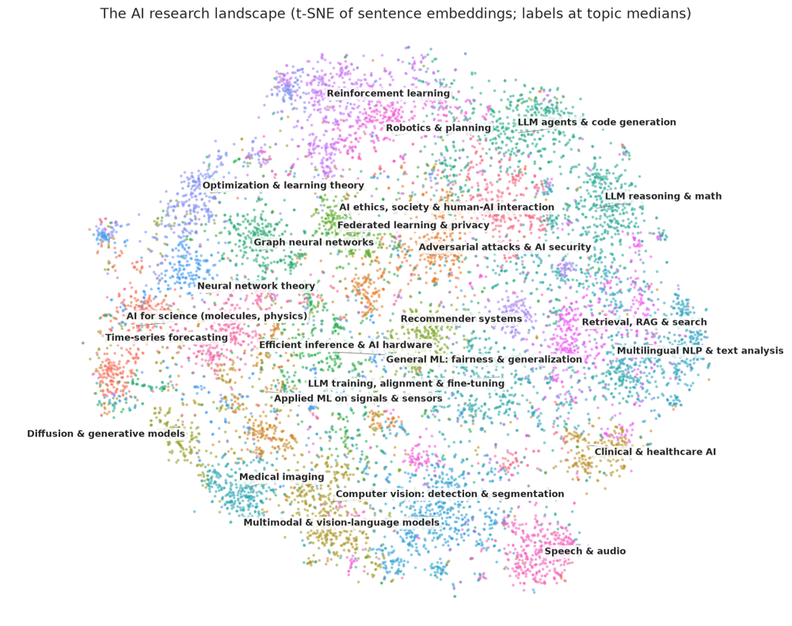
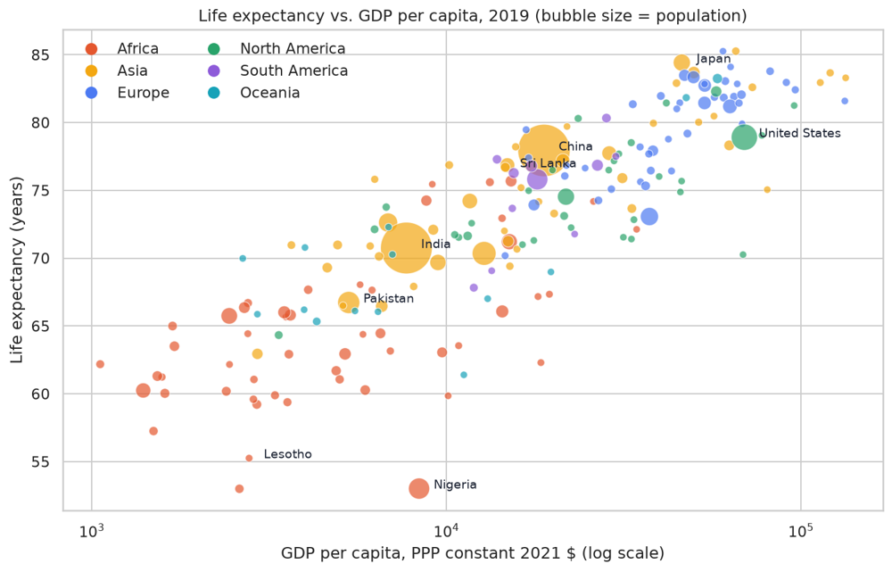
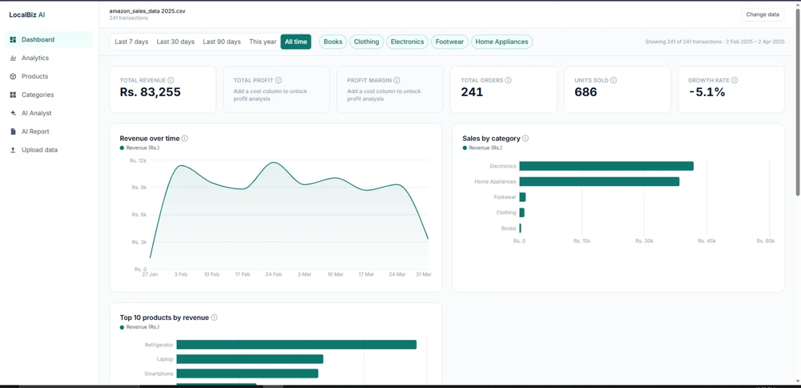
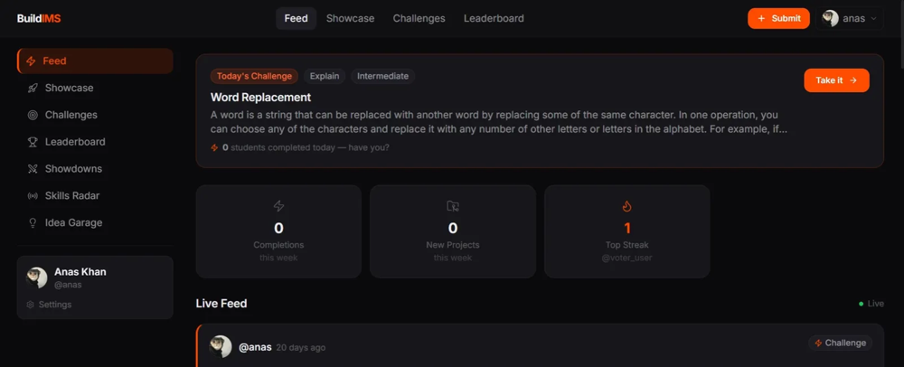

 

 

## About

Data Science student at **IMSciences Peshawar**, Pakistan, building end-to-end data projects: from collecting raw data through APIs, to analysis and machine learning, to interactive dashboards people can actually use.

- 🔭 Recently: mapped **12,060 AI research papers** with sentence embeddings, and modelled **life expectancy across 138 countries** with country-grouped cross-validation.
- 🛠️ I work with Python, SQL, scikit-learn and Power BI, and I care about **honest analysis**: careful validation, clearly stated limitations, and numbers that can be reproduced.
- 💼 Open to **data analyst and data science roles**, and available for freelance dashboard and analysis work on [Fiverr](https://www.fiverr.com/sellers/anasxm2/).

---

## Skills

<table width="88%" cellpadding="14" cellspacing="0" border="0">
<tbody>

<tr bgcolor="#0F172A">
<td width="155" align="right" valign="middle"><b>Languages</b></td>
<td align="left" valign="middle">
  &nbsp;
  &nbsp;
  &nbsp;
  &nbsp;
  
</td>
</tr>

<tr bgcolor="#111827">
<td align="right" valign="middle"><b>Data Analytics</b></td>
<td align="left" valign="middle">
  &nbsp;
  &nbsp;
  &nbsp;
  
</td>
</tr>

<tr bgcolor="#0F172A">
<td align="right" valign="middle"><b>Machine Learning</b></td>
<td align="left" valign="middle">
  &nbsp;
  &nbsp;
  &nbsp;
  
</td>
</tr>

<tr bgcolor="#111827">
<td align="right" valign="middle"><b>Visualization</b></td>
<td align="left" valign="middle">
  &nbsp;
  &nbsp;
  &nbsp;
  &nbsp;
  
</td>
</tr>

<tr bgcolor="#0F172A">
<td align="right" valign="middle"><b>Web &amp; Backend</b></td>
<td align="left" valign="middle">
  &nbsp;
  &nbsp;
  &nbsp;
  &nbsp;
  
</td>
</tr>

<tr bgcolor="#111827">
<td align="right" valign="middle"><b>Developer Tools</b></td>
<td align="left" valign="middle">
  &nbsp;
  &nbsp;
  &nbsp;
  &nbsp;
  
</td>
</tr>

</tbody>
</table>

---

## Featured Projects

<table>
<tr>
<td width="50%" valign="top">

### 🛰️ [AI Research Radar](https://github.com/anascs12/ai-research-radar)

**Problem:** thousands of AI papers appear every month. Which topics are rising, and can papers be found by meaning?

**Built:** embedded **12,060 arXiv papers** with sentence transformers, discovered 25 topics (k-means + class-based TF-IDF), measured trends, and built a semantic-search app.

**Finding:** LLM-agent papers grew **4.6×** in share (2.1% → 9.8%); about 23% of AI papers now mention agents.

</td>
<td width="50%" valign="top">

### 🌍 [What Drives Life Expectancy?](https://github.com/anascs12/life-expectancy-insights)

**Problem:** how much of the gap in life expectancy between countries do income, schooling, health spending, water and fertility explain?

**Built:** a reproducible pipeline on Our World in Data's API (found by tracing its charts with a reverse-engineering tool), data-quality checks, and models validated on **countries never seen in training**.

**Finding:** six factors explain **80%** of the variation (R² 0.80, error 2.6 years); a simple linear model beat random forest and gradient boosting.

</td>
</tr>
<tr>
<td width="50%" valign="top">

### 📈 [LocalBiz AI](https://github.com/anascs12/local-biz)

**Problem:** small Pakistani businesses keep sales in spreadsheets but have no way to turn them into decisions.

**Built:** a browser-based BI tool: upload a CSV or Excel file and get a dashboard, product intelligence, and an AI analyst grounded only in the user's real numbers. Data never leaves the browser.

**Quality:** **178 automated tests**; profit is hidden rather than estimated when cost data is missing.

</td>
<td width="50%" valign="top">

### 🏛️ [BuildIMS](https://github.com/anascs12/builtIMS)

**Problem:** IMSciences student developers had no shared platform to showcase projects, compete on coding challenges or collaborate on ideas.

**Built:** a full-stack platform with a project showcase, semester-aware daily challenges with streaks, leaderboards, faculty-judged showdowns and a real-time feed, plus a challenge generator fine-tuned from DistilGPT-2 on 1,408 LeetCode problems.

**Role:** Lead Developer (with Muneeba Saleem as Co-Lead Developer)

</td>
</tr>
</table>

### More projects

| Project | What it shows | Tools |
|---|---|---|
| [AI Job Market Dashboard](https://github.com/anascs12/Ai-job-posting) · [post](https://www.linkedin.com/posts/anas-khan-ds_aijobs-datavisualization-powerbi-activity-7357362856561967104-pO-4) | 15,000 AI job postings across 20 countries; median salary ≈ $100K; Python is the most-requested skill (29.7% of postings) | Power BI, Excel |
| [Customer Sales Analytics](https://github.com/anascs12/Customer-sales-data) · [post](https://www.linkedin.com/posts/anas-khan-ds_dataanalytics-portfolio-python-activity-7372580522931146752-4qNt) | 99,457 retail transactions; clothing drives ~45% of revenue; steady 8–10M revenue per month | Python, pandas, Matplotlib |
| [Life Expectancy Analysis](https://github.com/anascs12/Life-expectancy-data-analysis) · [post](https://www.linkedin.com/posts/anas-khan-ds_dataanalytics-powerbi-sql-activity-7359893014611140608-Edfk) | WHO data for 193 countries (2000–2015); schooling correlates with life expectancy at r = 0.75 | Excel, Power BI |
| [BuildIMS Challenge Generator](https://github.com/anascs12/buildims-challenge-generator) | Fine-tunes DistilGPT-2 on 1,408 cleaned LeetCode problems | PyTorch, Transformers |

---

## GitHub Analytics

<table border="0" cellspacing="0" cellpadding="6">
<tr>
<td>
  
</td>
<td>
  
</td>
</tr>
</table>

---

## Activity

  

 

  <picture>
    <source media="(prefers-color-scheme: dark)"  srcset="https://raw.githubusercontent.com/anascs12/anascs12/output/github-contribution-grid-snake-dark.svg" />
    <source media="(prefers-color-scheme: light)" srcset="https://raw.githubusercontent.com/anascs12/anascs12/output/github-contribution-grid-snake.svg" />
    
  </picture>

---

## Currently Learning

- **Retrieval & LLM systems:** hybrid search, re-ranking and evaluating retrieval quality
- **Time-series forecasting:** backtesting, feature engineering and forecast evaluation
- **MLOps basics:** reproducible pipelines, testing data code, and deploying models and dashboards
- **Statistics:** experimental design and hypothesis testing on real datasets

---

Thanks for visiting. Feel free to reach out on <a href="https://www.linkedin.com/in/anas-khan-ds/">LinkedIn</a> or by <a href="mailto:anasxm20@gmail.com">email</a>.

