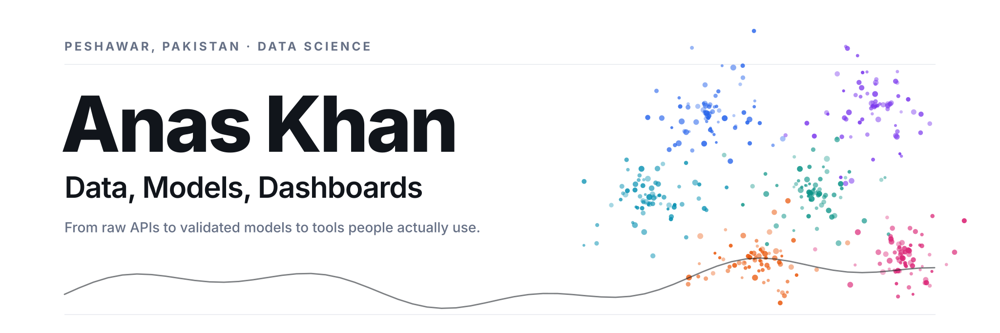
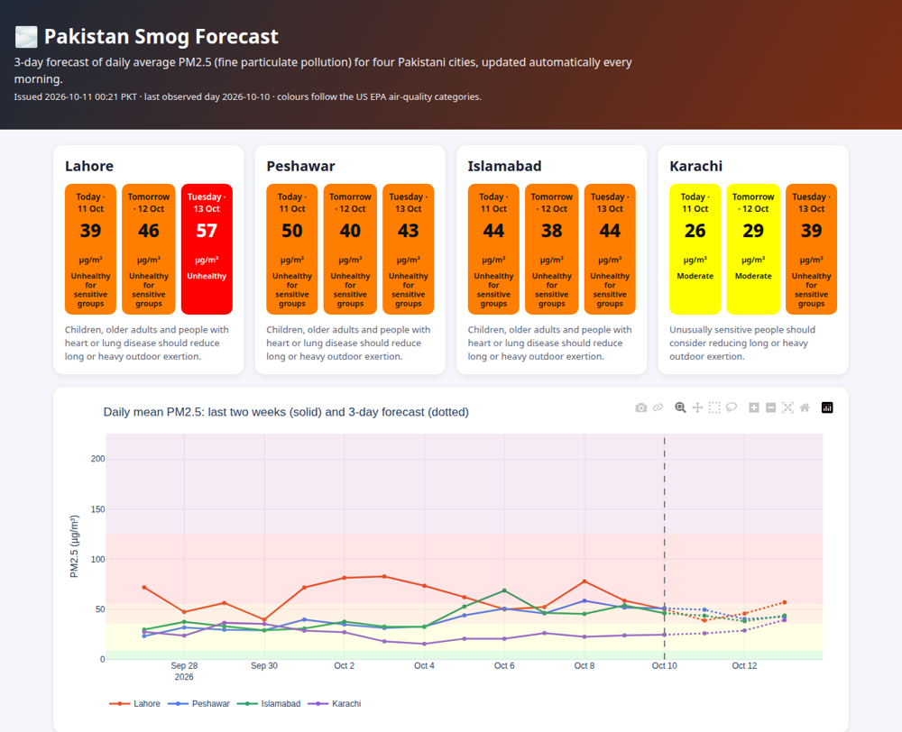

 

  

  

  12,060 arXiv papers, embedded, clustered into 25 topics and searchable by meaning.
   
  LLM-agent papers grew 4.6× in share; about 23% of AI papers now mention agents.

&nbsp;&nbsp;

 

### SpyGuard

An 8-phase privacy scanner that detects hidden cameras and trackers — WiFi, Bluetooth, infrared — with a desktop app, Android app and a curated spy-device database.

 

  

 

### Pakistan Smog Forecast

A new 1–3 day PM2.5 forecast for four cities, every morning.

It beats "same as today" by 21–31% in smog season.

&nbsp;

